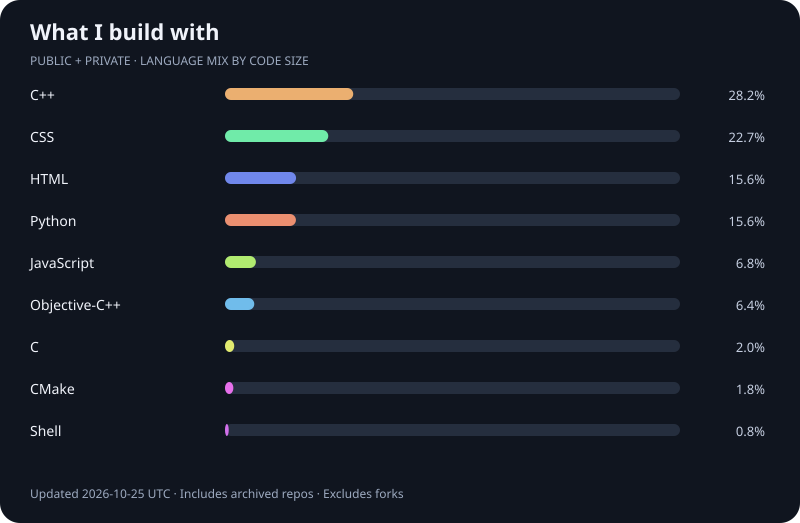

<h1 align="center">hey, i'm alya 👋</h1>

Small tools. Interactive interfaces. Ideas turned into code.

  <a href="https://github.com/alyasewar?tab=repositories">explore my projects ↗</a>

  

---

### Languages I build with

<!-- LANGUAGES:START -->

Refreshed daily. Percentages reflect code size, not coding time or proficiency.

<!-- LANGUAGES:END -->

### A few things I've built

| Project | What it does | Built with |
| :--- | :--- | :--- |
| 🎮 [OBS Input Visualizer](https://github.com/alyasewar/obs-gamepad-view) | Live controller, keyboard, and mouse overlays for OBS on macOS. | C++ |
| 🖼️ [Etsy Image Puller](https://github.com/alyasewar/etsy-image-downloader) | Preview, select, and download listing images as a ZIP. | Python |
| 🌐 [PM Website](https://github.com/alyasewar/pm-website) | A project website demo. Archived, with a [live preview](https://alyasewar.github.io/pm-website/). | HTML · CSS · JavaScript |

---

alyasewar · build something useful, make it feel good.

